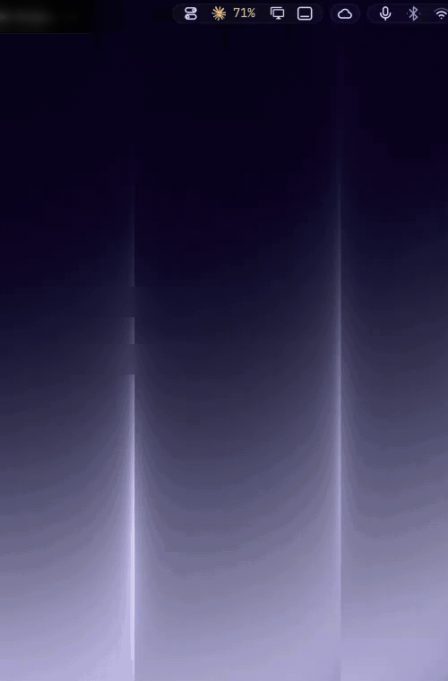

<div align="center">

# Island AI Usage

**How much of your AI coding limits you've used, in the Island look.**
Claude Code, Codex and Fireworks: rate-limit meters with pace, today, the last days and
the tokens by model, in a dark anatomy panel that opens under its icon.


</div>

## Why this one

- 📈 **The tightest limit first.** With [Island Bar](https://github.com/hugorolimf/omarchy-bar)
  the bar shows it next to the icon, amber from 70 %, red from 90 %, and the tip says when
  it resets.
- ✏️ **The Island look**: stroke icons, the providers' own logos, one easing curve.
- 🌍 **English or Portuguese.** The collectors' messages are shown as written in English,
  or translated for Portuguese systems.
- 👥 **Several Claude accounts.** Save more than one Claude Code login and switch
  between them from the panel; each saved account shows its own limits.
- 🔄 **Drop-in.** It's Omarchy's own `omarchy.agents` underneath: same collectors
  (`omarchy-agent-usage-*`), settings, sync and IPC.

## See it

Recorded on a real desktop, mouse included; the account e-mails are blurred. The
panel follows the system language; this take is in Portuguese.

**Limits, the last days and the tokens by model**, opened from the bar.



## Requirements

[Island Kit](https://github.com/hugorolimf/omarchy-island-kit): the panel is drawn with it.
Without the Kit, the plugin shows an "Install Island Kit" button on the bar
(in Portuguese, "Instale o Island Kit"); clicking it installs the Kit and
restarts the shell.

## Install

```bash
omarchy plugin add https://github.com/hugorolimf/omarchy-island-kit --enable
omarchy plugin add https://github.com/hugorolimf/omarchy-island-ai-usage --enable
```

## Saved Claude accounts

The active account is the login Claude Code itself uses (`~/.claude/.credentials.json`),
so every new terminal follows it. "Add account" opens a terminal where you sign in with
`claude`; the other logins wait in a private store and trade places with the active one
when you switch (the leaving login is saved first, since its tokens rotate while in use).
The panel never sees a token: `accounts.py status` gives it names, plans and meters only.

## Files it writes

- `~/.local/state/omarchy/io.github.hugorolimf.agents/claude-accounts.json`: the saved
  logins (folder `0700`, file `0600`). Only when you add a second account.
- `~/.claude/.credentials.json` (or `$CLAUDE_CONFIG_DIR/.credentials.json`): rewritten
  (`0600`) when you switch accounts.

Network: saved, inactive accounts are checked at most every 5 minutes against
Anthropic's own endpoints (`api.anthropic.com`, the same ones Omarchy's Claude collector
uses) to show their plan and limits. Nothing goes anywhere else.

## Remove

```bash
omarchy plugin remove io.github.hugorolimf.agents
```

Omarchy's own agents panel comes back to the bar. To forget the saved accounts as well:
`rm -r ~/.local/state/omarchy/io.github.hugorolimf.agents` (the active login stays).

## Credits

A clone of Omarchy's `omarchy.agents` by David Heinemeier Hansson and the
[Omarchy](https://github.com/basecamp/omarchy) contributors (MIT); the look and the
Portuguese wording are this plugin's. Provider logos belong to their owners.

## License

[MIT](LICENSE)
