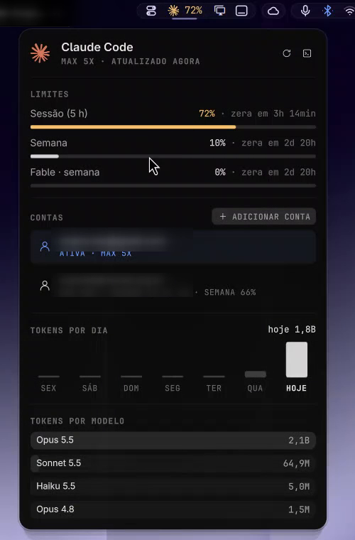

<div align="center">

# Island AI Usage

**How much of your AI coding limits you've used, in the Island look.**
Claude Code, Codex and Fireworks: rate-limit meters with pace, today, the last days and
the tokens by model, in a dark anatomy panel that opens under its icon.



</div>

## Why this one

- 📈 **The tightest limit first.** With [Island Bar](https://github.com/hugorolimf/omarchy-bar)
  the bar shows it next to the icon, amber from 70 %, red from 90 %, and the tip says when
  it resets.
- ✏️ **The Island look**: stroke icons, the providers' own logos, one easing curve.
- 🌍 **English or Portuguese.** The collectors' messages are shown as written in English,
  or translated for Portuguese systems.
- 🔄 **Drop-in.** It's Omarchy's own `omarchy.agents` underneath: same collectors
  (`omarchy-agent-usage-*`), settings, sync and IPC.

## Requirements

[Island Kit](https://github.com/hugorolimf/omarchy-island-kit): the panel is drawn with it.
Without the Kit, the plugin shows an "Install Island Kit" button on the bar
(in Portuguese, "Instale o Island Kit"); clicking it installs the Kit and
restarts the shell.

## Install

```bash
omarchy plugin add https://github.com/hugorolimf/omarchy-island-kit --enable
omarchy plugin add https://github.com/hugorolimf/omarchy-island-ai-usage --enable
```

## Remove

```bash
omarchy plugin remove io.github.hugorolimf.agents
```

Omarchy's own agents panel comes back to the bar.

## Credits

A clone of Omarchy's `omarchy.agents` by David Heinemeier Hansson and the
[Omarchy](https://github.com/basecamp/omarchy) contributors (MIT); the look and the
Portuguese wording are this plugin's. Provider logos belong to their owners.

## License

[MIT](LICENSE)
